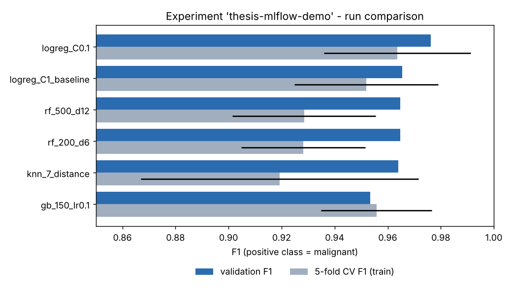
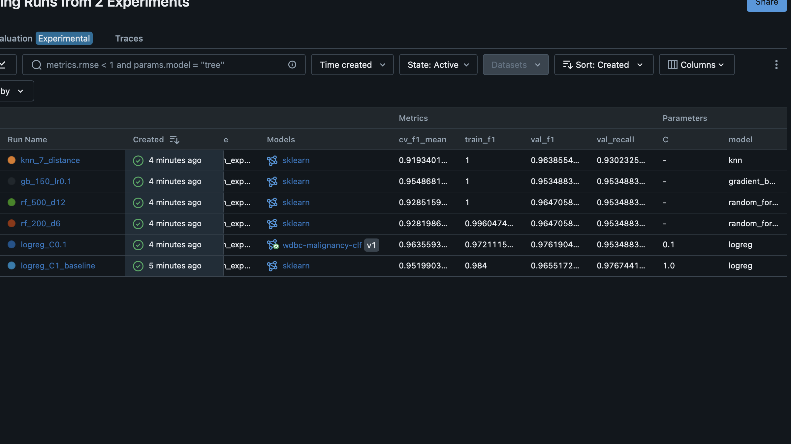

# MLflow experiment tracking - breast cancer classification

Project for the MLflow tutorial. I train a few classifiers, log everything to MLflow,
compare the runs, register the best model in the Model Registry and show how to retrain it
from the logged run.

## Task and data

Binary classification: is a tumour **malignant (1)** or **benign (0)**, based on 30 features
computed from cell nuclei images.

- Dataset: Breast Cancer Wisconsin (Diagnostic), 569 samples (212 malignant, 357 benign)
- Source: https://archive.ics.uci.edu/dataset/17/breast+cancer+wisconsin+diagnostic (DOI 10.24432/C5DW2B)
- License: CC BY 4.0
- I load it with `sklearn.datasets.load_breast_cancer()`, which is the same data, so nothing has to be downloaded
- SHA-256 of the data: `3019c221882c9c756a9b1c76da7ad72cf606ffe8e51791044aeaadeb33efbd12` (saved as `dataset_sha256` tag in each run)

In sklearn malignant is encoded as 0, I flipped it so malignant is the positive class.
Main metric is F1, and I also look at recall because missing a cancer is worse than a false alarm.

Split (same for all runs, seed 42, stratified): 60% train / 20% validation / 20% test.
All models are a pipeline `StandardScaler -> model`. I choose the model on validation,
and the test set is used only once in `register.py` for the selected model.

## Files

- `train.py` - trains one model and logs it to MLflow
- `run_experiments.py` - runs all 6 variants
- `compare.py` - comparison table and chart from MLflow (saved to `reports/`)
- `register.py` - picks the best run and registers it
- `src/common.py` - data split, models, git info
- `reports/` - exported results

## Setup

Python 3.9 - 3.12

```bash
python -m venv .venv
source .venv/bin/activate        # windows: .venv\Scripts\activate
pip install -r requirements.txt
```

## Tracking URI and UI

I use local SQLite (`sqlite:///mlflow.db`), it's the setup MLflow recommends for the Model Registry.
Artifacts go to `./mlruns`. If `MLFLOW_TRACKING_URI` is not set, the scripts use the same sqlite file anyway.

```bash
export MLFLOW_TRACKING_URI=sqlite:///mlflow.db
mlflow ui --backend-store-uri sqlite:///mlflow.db --default-artifact-root ./mlruns --port 5001
```

Then open http://127.0.0.1:5001 (on Mac port 5000 is often taken by AirPlay, that's why 5001).

There are no secrets in the repo. For a local setup they aren't needed at all. If you want a remote server,
put the URI / login / password into `.env` (example in `.env.example`). `.env`, credentials, `mlflow.db`,
`mlruns/` and raw data are in `.gitignore`.

## How to run

```bash
python run_experiments.py   # 6 runs in experiment "thesis-mlflow-demo"
python compare.py           # comparison -> reports/
python register.py          # registers the best model
```

One model with your own params, for example:
`python train.py --model random_forest --n-estimators 300 --max-depth 8`
(models: `logreg`, `random_forest`, `gradient_boosting`, `knn`, see `python train.py -h`).

## What is logged

- **params**: model type, all hyperparameters, `seed`, `val_size`, `test_size`, preprocessing, train/val sizes
- **metrics**: accuracy, precision, recall, f1, roc_auc for train and validation, F1 from 5-fold CV on train (mean and std), and `overfit_gap_f1` (train F1 minus val F1). The registered model also gets `test_*` metrics
- **artifacts**: the model (sklearn flavour with signature), confusion matrix, ROC curve, validation predictions csv, classification report, `run_config.json`
- **tags**: git commit, whether the tree was dirty, dataset url, license and hash. The baseline run has `role=baseline`

## Results

Table from `compare.py` (full version in `reports/runs_comparison.csv`):

| run | model | val F1 | val recall | val precision | val AUC | CV F1 | train F1 |
|---|---|---|---|---|---|---|---|
| **logreg_C0.1** | logistic regression, C=0.1 | **0.976** | 0.953 | 1.000 | 0.995 | **0.964** ± 0.028 | 0.972 |
| logreg_C1_baseline | logistic regression, C=1 | 0.966 | 0.977 | 0.955 | 0.996 | 0.952 ± 0.027 | 0.984 |
| rf_500_d12 | random forest, 500 trees, depth 12 | 0.965 | 0.953 | 0.976 | 0.993 | 0.929 ± 0.027 | 1.000 |
| rf_200_d6 | random forest, 200 trees, depth 6 | 0.965 | 0.953 | 0.976 | 0.992 | 0.928 ± 0.023 | 0.996 |
| knn_7_distance | kNN, k=7 | 0.964 | 0.930 | 1.000 | 0.997 | 0.919 ± 0.052 | 1.000 |
| gb_150_lr0.1 | gradient boosting, 150 trees | 0.953 | 0.953 | 0.953 | 0.991 | 0.956 ± 0.021 | 1.000 |



<!--  -->

**Best model: `logreg_C0.1`** (logistic regression with stronger regularization).
It has the best validation F1 and also the best CV F1, so it's not just a lucky split.
Train and validation F1 are almost the same, so it doesn't overfit. Random forest, boosting and kNN
get 1.0 on train but are worse on validation. It's also the simplest model, so there was no reason
to choose something more complex. On this dataset more complex models didn't help.

The baseline (C=1) has a bit higher recall (it found one more malignant case out of 43),
but lower precision and F1.

Test set (only for the chosen model): accuracy 0.982, precision 1.000, recall 0.952, **F1 0.976**,
ROC AUC 0.998. Pretty much the same as on validation.

## Model Registry

The model is registered as **`wdbc-malignancy-clf`, version 1**, with alias **`@champion`**
(in MLflow 2.x aliases are used instead of the old Staging/Production stages).
The version also has tags with val/test F1, git commit and dataset hash. Results are also saved
in `reports/registry_result.json`.

Loading the model:

```python
import mlflow
mlflow.set_tracking_uri("sqlite:///mlflow.db")
model = mlflow.pyfunc.load_model("models:/wdbc-malignancy-clf@champion")
```

### Promotion criteria

I take the run with the best validation F1 (if equal, better CV F1, then the simpler model).
It gets the `champion` alias only if: its validation F1 is not lower than the baseline (0.966),
validation recall is at least 0.95 (missing a cancer is the worst kind of error here), and F1 on the
test set is at least 0.93, to check that the model wasn't just picked because it got lucky on validation.
If something fails, it gets `challenger` and the old champion stays. Version 1 passed all three
(0.976, 0.953, 0.976).

## Reproducibility

Best run: **`f27535c007a64aacb0c8c4dd0579b01c`** (`logreg_C0.1`)

- git commit: `ff182dd`, clean tree (`git_commit` and `git_dirty=false` tags in the run)
- data: UCI WDBC from sklearn, sha256 `3019c221...efbd12`
- params: `model=logreg, C=0.1, max_iter=1000, seed=42, val_size=0.2, test_size=0.2`
- versions: `requirements.txt` (the model artifact also has its own `requirements.txt`)

Get the params of the run:

```bash
export MLFLOW_TRACKING_URI=sqlite:///mlflow.db
mlflow runs describe --run-id f27535c007a64aacb0c8c4dd0579b01c
```

Go to the same code version:

```bash
git checkout ff182dd
```

Retrain with params from the run:

```bash
python train.py --config-from-run f27535c007a64aacb0c8c4dd0579b01c
```

or the same thing with normal flags:

```bash
python train.py --model logreg --C 0.1 --max-iter 1000 --seed 42 --val-size 0.2 --test-size 0.2
```

With `--config-from-run` the script creates a new run (tag `reproduced_from_run`) and compares
the metrics with the original:

```
Reproducibility check (original vs re-run):
  val_f1       0.976190 vs 0.976190  OK
  val_roc_auc  0.995087 vs 0.995087  OK
  cv_f1_mean   0.963559 vs 0.963559  OK
  -> identical
```

Note: `mlflow.db` and `mlruns/` are not in the repo. If you run everything from scratch, run ids will
be different (take them from `compare.py` or the UI), but the metrics will be the same, because seed and
split are fixed.
