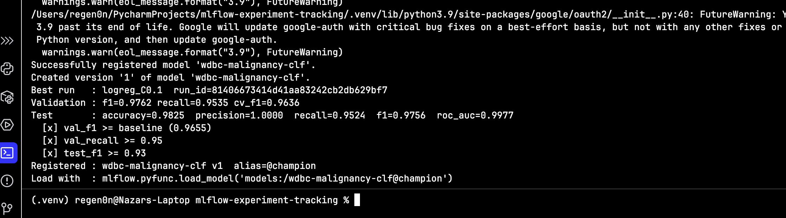

# MLflow experiment tracking

Breast cancer classification (malignant / benign) with MLflow tracking and Model Registry.
I train 6 models, log them to MLflow, compare them and register the best one.

## Data

Breast Cancer Wisconsin (Diagnostic) from UCI, 569 samples, 30 features.

- https://archive.ics.uci.edu/dataset/17/breast+cancer+wisconsin+diagnostic
- license: CC BY 4.0

It's loaded with `sklearn.datasets.load_breast_cancer()` (same dataset), so nothing needs to be downloaded.
The sha256 of the data is saved in every run as the `dataset_sha256` tag
(`3019c221882c9c756a9b1c76da7ad72cf606ffe8e51791044aeaadeb33efbd12`).

Malignant = 1. The main metric is F1, I also check recall because a missed cancer is the worst error.
Split is 60/20/20 (train/val/test), stratified, seed 42, the same for all runs. Every model is
`StandardScaler` + classifier. I compare models on validation, the test set is used only once
for the chosen model in `register.py`.

## Setup

```bash
python3 -m venv .venv
source .venv/bin/activate
pip install -r requirements.txt
```

Tracking URI is `sqlite:///mlflow.db` (local file, artifacts go to `./mlruns`).
If `MLFLOW_TRACKING_URI` isn't set the scripts use it by default.

UI:

```bash
mlflow ui --backend-store-uri sqlite:///mlflow.db --default-artifact-root ./mlruns --port 5001
```

and open http://127.0.0.1:5001 (I use 5001 because on Mac 5000 is taken by AirPlay).

No passwords or keys in the repo. For a remote server you can put them into `.env`
(see `.env.example`), it's in `.gitignore` together with `mlflow.db` and `mlruns/`.

## Run

```bash
python run_experiments.py   # trains 6 models, experiment "thesis-mlflow-demo"
python compare.py           # saves comparison to reports/
python register.py          # registers the best model
```

Single model: `python train.py --model random_forest --n-estimators 300 --max-depth 8`
(`python train.py -h` for all options).

Each run logs:
- params: model, hyperparameters, seed, split sizes
- metrics: accuracy / precision / recall / f1 / roc_auc on train and val, 5-fold CV F1 on train
- artifacts: model, confusion matrix, ROC curve, val predictions (csv), classification report
- tags: git commit, dataset url / license / hash

## Results

| run | model | val F1 | val recall | CV F1 | train F1 |
|---|---|---|---|---|---|
| logreg_C0.1 | logistic regression C=0.1 | 0.976 | 0.953 | 0.964 | 0.972 |
| logreg_C1_baseline | logistic regression C=1 | 0.966 | 0.977 | 0.952 | 0.984 |
| rf_500_d12 | random forest 500 trees, depth 12 | 0.965 | 0.953 | 0.929 | 1.0 |
| rf_200_d6 | random forest 200 trees, depth 6 | 0.965 | 0.953 | 0.928 | 0.996 |
| knn_7_distance | kNN k=7 | 0.964 | 0.930 | 0.919 | 1.0 |
| gb_150_lr0.1 | gradient boosting 150 trees | 0.953 | 0.953 | 0.955 | 1.0 |

Full table: `reports/runs_comparison.csv`.


The best one is `logreg_C0.1`. It has the highest F1 on validation and in CV, and train and val
scores are almost the same, so it doesn't overfit. Random forest, boosting and kNN get 1.0 on train
but are worse on validation. Logistic regression is also the simplest model, so I don't see a reason
to take anything more complex here. The baseline has a bit higher recall (one more malignant case
found out of 43) but worse precision and F1.

On the test set: accuracy 0.982, recall 0.952, F1 0.976, ROC AUC 0.998.

## Model Registry

Registered as `wdbc-malignancy-clf` version 1 with alias `champion`
(MLflow 2.x uses aliases instead of Staging/Production).



```python
model = mlflow.pyfunc.load_model("models:/wdbc-malignancy-clf@champion")
```

Promotion rule: the run with the best validation F1 gets `champion` only if its val F1 is not lower
than the baseline, val recall is at least 0.95 and test F1 is at least 0.93. Otherwise it gets
`challenger` and the current champion stays. Version 1 passed all three.

## Reproducing the best run

- run id: `81406673414d41aa83242cb2db629bf7`
- git commit: `aa311f0` (clean, no local changes)
- params: logreg, C=0.1, max_iter=1000, seed=42, val_size=0.2, test_size=0.2
- data: UCI dataset via sklearn, hash above

```bash
mlflow runs describe --run-id 81406673414d41aa83242cb2db629bf7   # see params
git checkout aa311f0
python train.py --config-from-run 81406673414d41aa83242cb2db629bf7
```

or the same with flags:

```bash
python train.py --model logreg --C 0.1 --max-iter 1000 --seed 42
```

`--config-from-run` reads the params from the run, trains again and prints a comparison with the
original metrics (for me they were identical). Run ids will be different if you run everything
from scratch, but the metrics stay the same because the seed and split are fixed.
